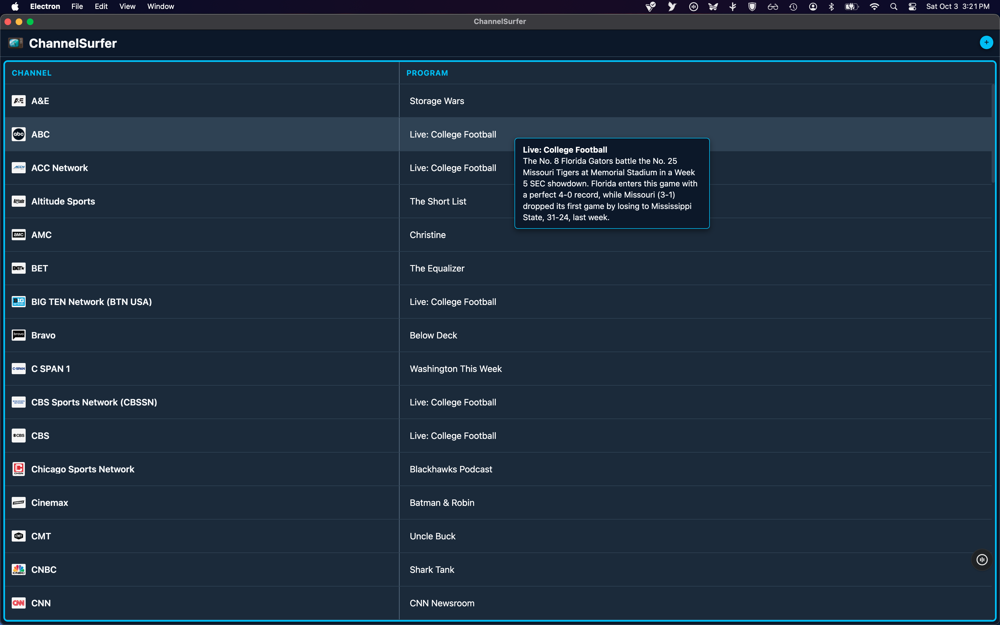
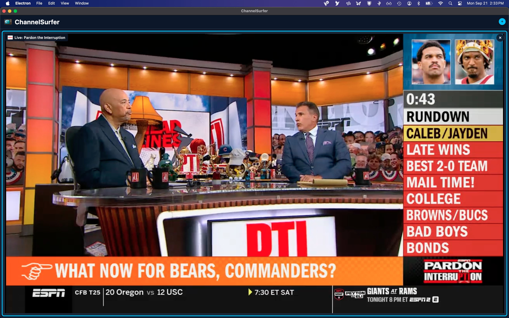
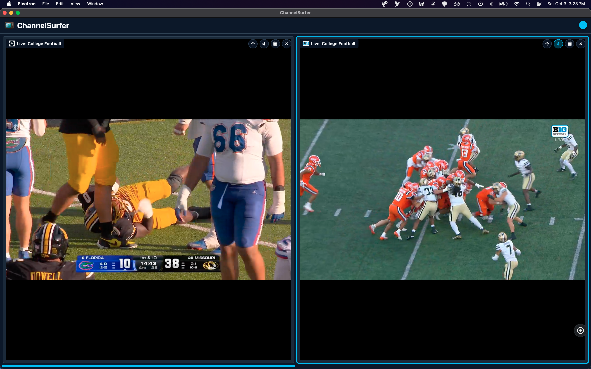
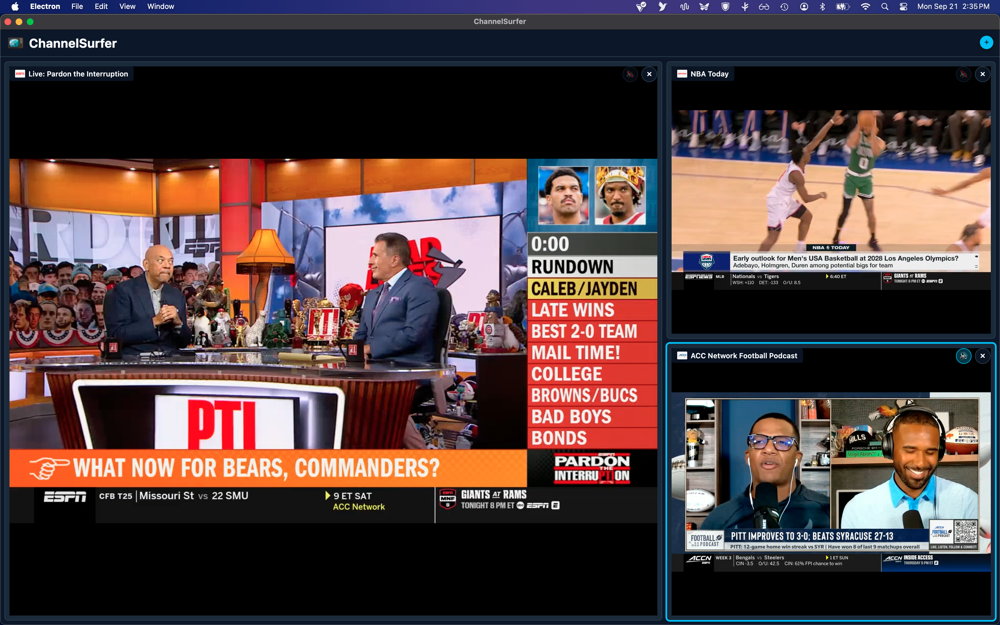
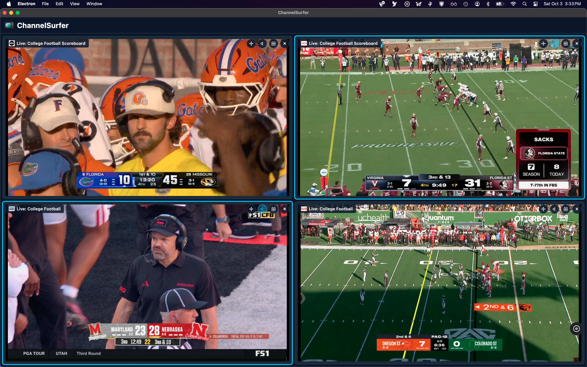

# ChannelSurfer

A desktop app for browsing and watching live TV streams, with a modern program guide. Watch one channel, or up to four at once.

## Contents

- [Screenshots](#screenshots)
- [Features](#features)
- [Installation](#installation)
- [Getting Started](#getting-started)
- [Program Guide Accuracy](#program-guide-accuracy)
- [Troubleshooting](#troubleshooting)
- [Building From Source](#building-from-source)
- [Contributing](#contributing)
- [License](#license)
- [Credits](#credits)
- [Disclaimer](#disclaimer)

## Screenshots

### Program Guide



### One Channel



### Two Channels



### Three Channels



### Four Channels



## Features

- **Program guide** – See what's on across all stations. Hover over a program to read its description.
- **Multi-view** – Watch up to four channels at once. The layout adjusts automatically.
- **Automatic recovery** – If a stream stops working or freezes, ChannelSurfer switches to a backup source or restarts the stream for you.
- **Built-in protection** – Blocks ads, trackers, malicious domains, and pop-up windows.
- **Dark interface** – Easy on the eyes in a dim room.

## Installation

Download the file for your system from the [Releases page](https://github.com/channelsurfer-1/ChannelSurfer/releases/latest).

### macOS

1. Download `ChannelSurfer-universal.dmg`. (A smaller version of the app, `ChannelSurfer-intel.dmg`, is also available for Intel Macs.)
2. Open it and drag **ChannelSurfer** into your **Applications** folder.
3. The first time you open it, macOS may warn that the app is from an unidentified developer. Right-click the app, choose **Open**, then confirm.

### Windows

1. Download `ChannelSurfer-win32-x64.zip`.
2. Extract the zip to any folder.
3. Double-click `ChannelSurfer.exe`.
4. If Windows SmartScreen warns you, click **More info**, then **Run anyway**.

### Linux

1. Download `ChannelSurfer-linux-x64.tar.gz`.
2. Open a terminal and run:
   ```bash
   tar -xzf ChannelSurfer-linux-x64.tar.gz
   cd ChannelSurfer-linux-x64
   ./ChannelSurfer
   ```
   If you get a permission error, run `chmod +x ChannelSurfer` from a terminal first.

## Getting Started

1. **Launch the app.** The program guide loads and opens automatically.
2. **Pick a program.** Click it to start watching.
3. **Add more views.** Click **+** (top right) to watch another channel at the same time.
4. **Close a view.** Click **×** on it. The other views keep playing and expand to fill the space. Closing the last view takes you back to the guide.

### Using the program guide

- Click an empty view to open the guide there.
- Click the **calendar button** on a playing view to browse the guide without interrupting the stream. Press **Esc** (or click the highlighted current program) to go back to it.
- Drag the divider between the Channel and Program columns to resize them.

### Watching multiple channels

- **Layout:** Two views sit side by side, three views show one large and two small, and four views form a 2×2 grid.
- **Swap views:** Drag the move icon in a view's top-right corner onto another view and hold for a moment. The two streams trade places instantly.
- **Choosing which view you hear:** Only one view plays sound at a time. The speaker icon in a view's top-right corner shows which one. It's blue on the active view; click the grey speaker on any other view to switch to it. The newest view you add gets the sound automatically.
- **Volume and mute:** Use the speaker in the player's control bar at the bottom of a stream. It only affects that one stream. Volume controls on a view that isn't playing sound are greyed out until you make it the active view.
- **Fullscreen:** Click the fullscreen button on a view to expand it. That view plays sound while fullscreen, and the previous audio choice returns when you exit.

**Tip:** Every open view uses internet bandwidth, so viewing four streams concurrently will require a fast connection.

### Sound

- Streams start with sound on. There's no "click to unmute" step.
- New programs start at 50% volume, then use whatever level you last set.
- The volume bar and mute button always show what you're actually hearing.

### Player controls

Just like on the source website, the controls fade out after about a second without mouse movement and return when you move the mouse over the video.

## Program Guide Accuracy

The guide uses publicly available program schedule data. It works well for national networks, but local broadcast stations (CBS, ABC, NBC, FOX) may not match the exact feed the stream uses. Treat the schedule as a helpful guide, not a guarantee.

## Troubleshooting

### A channel won't play

1. **Try another channel.** If others work, the problem is with that one stream. Try again later.
2. **Read the message in the view.** "Could not connect to server" means every stream source failed to respond. That usually points to your internet connection, or to the source site blocking connections from your region or network.
3. **Restart the app.** ChannelSurfer checks for fixes each time it starts.

### "Unable to load program guide..."

The app couldn't reach the schedule data, usually because of your internet connection or a temporary outage. It keeps retrying automatically, and the guide appears as soon as it connects. You don't need to restart. Streams need a connection too, so channels won't play until this is resolved.

### Automatic updates to stream sources

Stream sources change without notice from time to time. To keep up, ChannelSurfer downloads a small settings file each time it starts, listing which stream addresses and domains to use. This lets fixes reach everyone without a new download. If every channel stops working, restart the app, or download the latest release.

### Reporting a problem (debug mode)

If you're [opening an issue](https://github.com/channelsurfer-1/ChannelSurfer/issues), a debug log helps a lot. Run the app from the project folder like this:

```bash
CHANNELSURFER_DEBUG=1 npm start
```

Debug mode records detailed information about network activity and stream loading. Normal use isn't affected.

<details>
<summary>Advanced: the recovery dialog (debug mode only)</summary>

If every stream source fails while debugging, a recovery dialog may list domains that were blocked while the player loaded. Each one is labeled:

- **chain** – Very likely needed by the player. Pre-selected.
- **chain?** – Possibly needed. Your call.
- **likely ad** – Almost certainly an ad. Not selected.

Click **Test selected** to try the checked domains. If playback recovers, you will be offered the option to save the checked domains locally and you'll see a short snippet to send to the maintainer. The app then watches the stream for 60 seconds, and if playback fails within that time, the domains will be removed again. Domains that fail are remembered and not tried again. Once a domain is added to the shared settings, your local copy is cleaned up the next time you launch. The app never changes the shared settings itself.

</details>

## Building From Source

```bash
npm install             # first time only
npm run package         # macOS (.dmg)
npm run package:win     # Windows (.zip)
npm run package:linux   # Linux (.tar.gz)
npm run package:all     # all platforms
```

Finished builds appear in the `dist/` folder, which isn't part of the repository. To share them, attach the files to a GitHub Release.

## Contributing

Bug reports and feature requests are welcome. Please [open an issue](https://github.com/channelsurfer-1/ChannelSurfer/issues).

## License

GPL-3.0. See [LICENSE](LICENSE) for details.

## Credits

Vibe coded collectively by Z.ai, Kimi.ai and DeepSeek (free editions).

Made with [Electron](https://electronjs.org/) and [@electron/packager](https://github.com/electron/packager).

## Disclaimer

ChannelSurfer is a viewer for publicly available streams. The maintainers aren't responsible for the content of those streams or for whether using them complies with the laws where you live.

ChannelSurfer doesn't collect, store, or send any personal data. No analytics, no telemetry, no crash reporting - and your config and recovery data stay on your machine.

That said, ChannelSurfer is a browser for third-party live TV sites. When you watch, those sites and their streaming CDNs can see your IP address and may try to track you - the app can't stop that. It ships with a default-deny blocker for known ad and tracking domains, and it reads (but never writes) a public remote config. Functional requests like the config and program-guide fetches do reveal your IP to those hosts.
