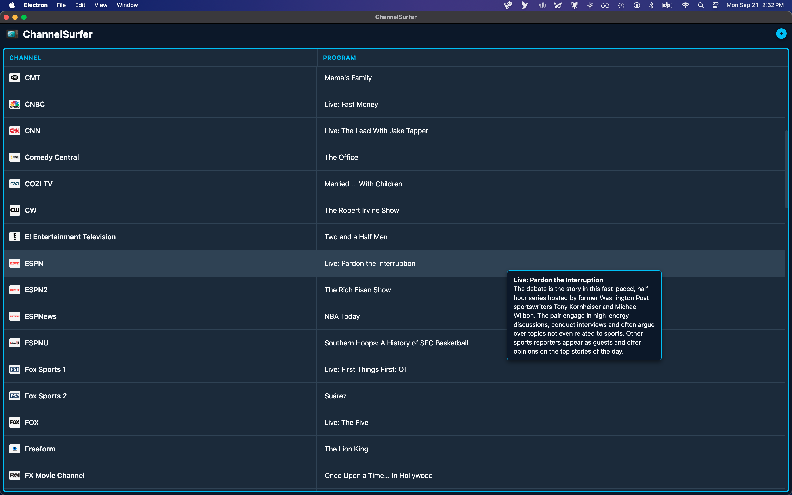

# ChannelSurfer

A desktop application for browsing and watching live TV streams with a rich, modern program guide.

## Contents

- [Screenshots](#screenshots)
- [Features](#features)
- [Installation](#installation)
- [Releases](#releases)
- [How It Works](#how-it-works)
- [Program Guide Accuracy](#program-guide-accuracy)
- [Configuration](#configuration)
- [Troubleshooting](#troubleshooting)
- [Build](#build)
- [Contributing](#contributing)
- [License](#license)
- [Credits](#credits)
- [Built With](#built-with)
- [Disclaimer](#disclaimer)

## Screenshots

### Program Guide



### Single View Mode


### Dual View Mode


### Three View Mode


### Four View Mode


## Features

### 📋 Program Guide

Browse current programming across all available stations.

- Click an empty panel to open the program guide
- Click the **calendar button** on any view to browse the guide over what's playing — the stream keeps running underneath and the layout doesn't change
- Press **Escape** (or click the highlighted current program) to return to the stream — it never stopped playing
- The current program's row is highlighted in the guide
- The program guide shows program titles and descriptions (on hover)
- Drag the divider between the Channel and Program columns to resize them

### 🖥️ Multi-View Watching

Watch up to four channels at once.

- Click the **+** button (top right) to add another view — the screen
  rearranges itself: two views side by side, three with one large view,
  four in a 2×2 grid. The layout is automatic; there's nothing to choose.
- Click **×** on a view to close it. The remaining views keep playing and
  reflow to fill the space; closing the last view returns it to the guide.
- Only one view plays audio at a time. The highlighted 🔊 button marks
  which one; click the greyed 🔇 on any other view to move the audio there.
- A view that isn't playing audio has its volume controls dimmed and
  disabled — activate the view first, then adjust.
- Individual views expand to fullscreen when the player's fullscreen
  button is clicked.
- Every live view consumes network bandwidth.

### 🔊 Sound Where You Expect It

- Streams start with audio already on — no "click to unmute" step.
- Programs start at 50% volume and pick up whatever volume you last set
  while another program was playing.
- The player's volume bar and mute button always reflect what you're
  actually hearing.

### 🔄 Automatic Failover

The stream source occasionally changes the domains and URL paths it uses to serve content. When this happens, ChannelSurfer tries a list of known player URLs in order and uses the first one that plays. Recovery is automatic — no action needed from the user.

### 🛡️ Built-in Protection

ChannelSurfer blocks intrusive ads, trackers, and malicious domains, and prevents pages from opening pop-up windows.

### 🌙 Modern Dark Interface

Designed for comfortable viewing in low-light environments.

## Installation

### 🍎 macOS
1. Download `ChannelSurfer-universal.dmg` from the [latest release](../../releases/latest).
2. Open the DMG and drag `ChannelSurfer.app` into your **Applications** folder.
3. On first launch, macOS may warn that the app is from an unidentified developer. Right-click the app and select **Open**, then confirm.

### 🪟 Windows
1. Download `ChannelSurfer-win32-x64.zip` from the [latest release](../../releases/latest).
2. Extract the zip to a folder of your choice.
3. Double-click `ChannelSurfer.exe`.
4. On first launch, Windows SmartScreen may warn you. Click **More info** → **Run anyway**.

### 🐧 Linux
1. Download `ChannelSurfer-linux-x64.tar.gz` from the [latest release](../../releases/latest).
2. Extract:
   ```bash
   tar -xzf ChannelSurfer-linux-x64.tar.gz
   cd ChannelSurfer-linux-x64
   ```
3. Run:
   ```bash
   ./ChannelSurfer
   ```
   If the executable bit was lost during transfer, restore it with `chmod +x ChannelSurfer`.

## Releases

Pre-built binaries for macOS, Windows, and Linux are available on the
[Releases page](https://github.com/channelsurfer-1/ChannelSurfer/releases).

## How It Works

1. Launch the app. It loads the program guide first — a brief "Loading the
   program guide..." message appears, then the guide opens on its own.
   The guide also reopens by itself whenever your only view is empty; in
   multi-view, click "Click to select a program" in an empty view to open
   it there.
2. Click the program you want to watch — it starts playing, with sound.
3. Click **+** to add another view and pick a program for it. Audio moves
   to the newest view automatically; the 🔊 button on any view moves it
   back.
4. Click the **calendar button** on a playing view to browse the guide
   without leaving it. The stream keeps playing underneath; press
   **Escape** to return to it, or pick any program to switch.
5. Click **×** on a view to close it.

- While a stream is playing, the player controls behave the same way as on the
  source site — they fade out after about a second of mouse inactivity and
  reappear as soon as you move the mouse over the video.

If the primary stream URL fails, the app automatically tries alternate
sources before giving up. A brief "Connecting..."
message appears in the view during this process.

## Program Guide Accuracy

The program guide relies on publicly available EPG data.

It works well for national networks. Broadcast networks like CBS, ABC, NBC, and FOX may not always match the exact local feed used by the stream source.

Treat the schedule as a helpful guide rather than an authoritative source.

## Configuration

ChannelSurfer loads a small remote configuration file on startup. This allows
the maintainer to update the list of trusted domains and the list of stream
player URLs without rebuilding or redistributing the app — fixes reach every
install on their next launch.

**How to update (maintainer):** edit the config gist, then restart the app.
No rebuild, no re-release.

**Normal users never need to touch configuration.** If channels stop playing
across the board, the fix is usually a config update — update the app or wait
for the shared config to refresh, then try again.

## Troubleshooting

### A channel won't play

1. **Try a different channel.** If others work, it's that one stream — try again later.
2. **Look at the message in the panel.** "Could not connect to server." means every stream source failed to respond — usually your network connection, or the *source site* refusing connections (regional or IP-based). If other channels work, it's that one stream; try again later.
3. **Restart the app.** The shared config updates at launch; a fix may already be live.

### The guide says "Unable to load program guide..."

The app could not reach the EPG source to build the program guide. This is
almost always a network problem on your side, or the source being temporarily
down. The app keeps retrying on its own — the guide appears as soon as a
connection succeeds, no restart needed. Keep in mind that streams need
network too, so if the guide can't load, channels won't play either.

### Getting detailed logs (debug mode)

If a problem keeps happening — and you're reporting it — run with debug logging
and attach the log:

```bash
CHANNELSURFER_DEBUG=1 npm start
```

Debug mode adds detailed instrumentation (every network request, response
statuses, page navigations, per-candidate timing). Normal runs are unaffected.

### The recovery dialog

When every stream source fails, the app normally shows "Could not connect to
server." In a debug run, a recovery dialog may appear instead, listing domains
that were blocked while the player loaded:

- `chain` — strong evidence this domain is part of the player; pre-selected.
- `chain?` — possibly part of the player; your call.
- `likely ad` — almost certainly an ad; left unselected.

Click **Test selected** to try the checked set. If playback recovers, the
domains are saved on your machine and you're shown a short snippet to share
with the maintainer. Failed guesses are remembered and won't be repeated.
The app never changes the shared configuration by itself.

## Build

```bash
npm install             # first run only
npm run package         # macOS (.dmg)
npm run package:win     # Windows (.zip)
npm run package:linux   # Linux (.tar.gz)
npm run package:all     # all platforms, in order
```

Output goes to `dist/` (not part of the repository; attach the artifacts to a
GitHub Release to distribute them).

## Contributing

Bug reports and feature requests are welcome — please [open an issue](https://github.com/channelsurfer-1/ChannelSurfer/issues).

## License

GPL-3.0. See [LICENSE](LICENSE) for details.

## Credits

Built by vibe coding with DeepSeek and Kimi.ai (Free Editions), under the direction of Joel Budgor.

## Built With

- [Electron](https://electronjs.org/) — cross-platform desktop framework
- [@electron/packager](https://github.com/electron/packager) — packaging and distribution

## Disclaimer

ChannelSurfer is a viewer that plays publicly available streams. The maintainers
are not responsible for the content of those streams or for compliance with
local laws regarding their use.