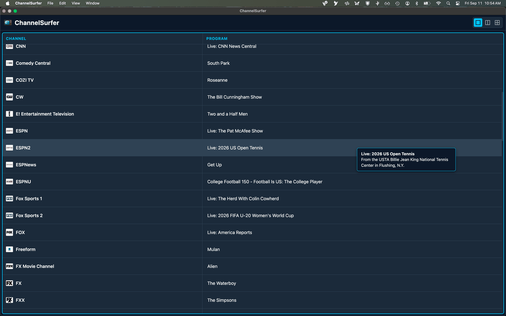
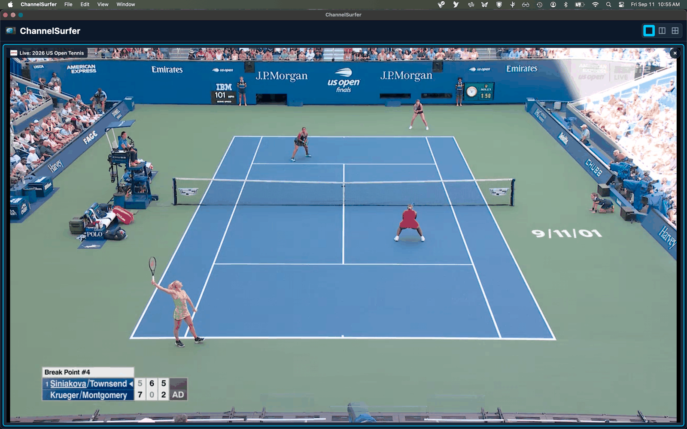
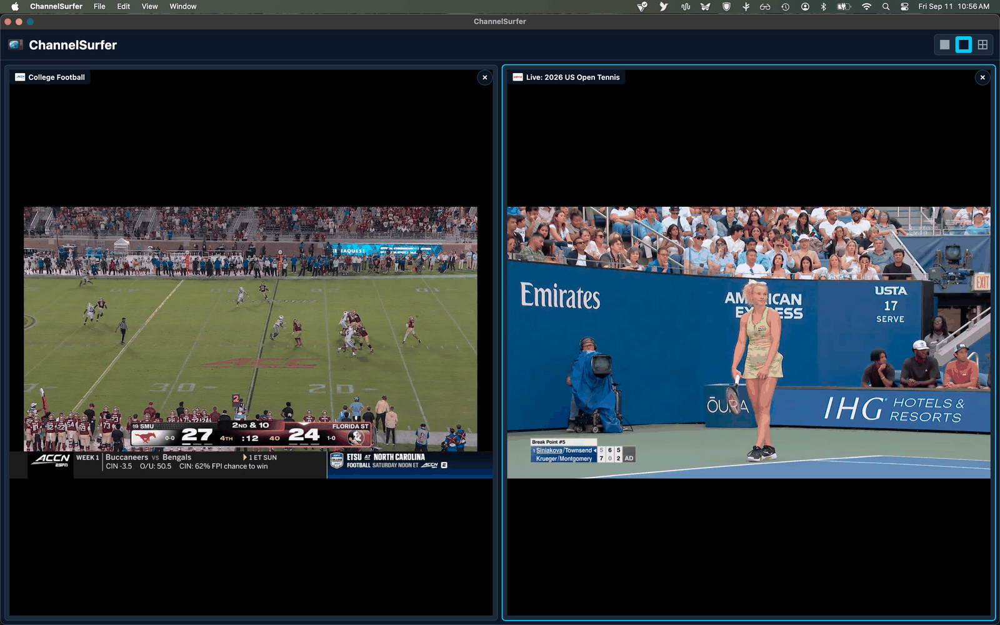
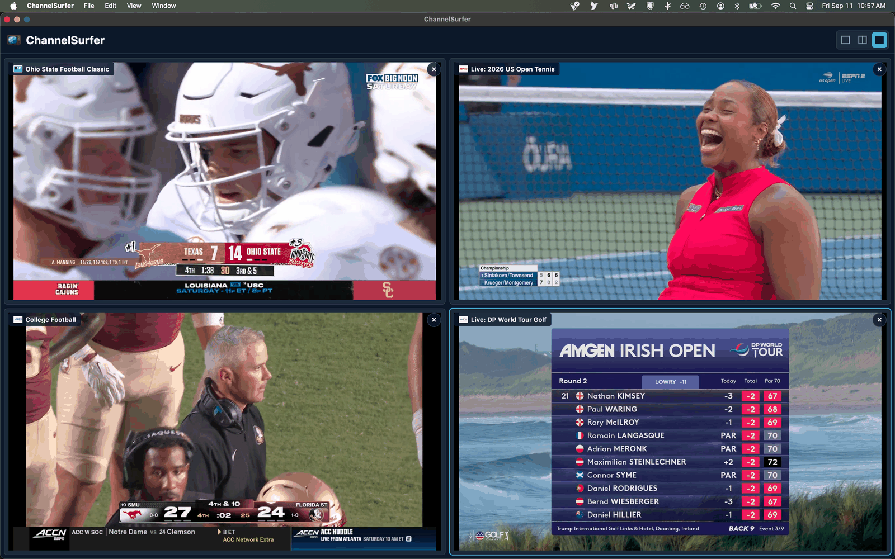

# ChannelSurfer

A desktop application for browsing and watching live TV streams with a rich, modern program guide.

## Contents

- [Screenshots](#screenshots)
- [Features](#features)
- [Installation](#installation)
- [Releases](#releases)
- [How It Works](#how-it-works)
- [Program Guide Accuracy](#program-guide-accuracy)
- [Build](#build)
- [Contributing](#contributing)
- [License](#license)
- [Credits](#credits)
- [Built With](#built-with)
- [Disclaimer](#disclaimer)

## Screenshots

### Program Guide



### Single View



### Dual View



### Grid View



## Features

### 📋 Program Guide

Browse current programming across all available stations.

- Click an empty panel to open the program guide
- The program guide shows program titles and descriptions (on hover)

### 🖥️ Multi-View Watching

Watch multiple channels at once.

- **Single View** — Watch one program
- **Dual View** — Watch two programs concurrently
- **Grid View** — Watch up to four programs concurrently
- Individual panels expand to fullscreen when the player's fullscreen button is clicked

### 🛡️ Built-in Protection

ChannelSurfer blocks intrusive ads, trackers, and malicious domains.

### 🌙 Modern Dark Interface

Designed for comfortable viewing in low-light environments.

## Installation

### 🍎 macOS
1. Download `ChannelSurfer-universal.dmg` from the [latest release](../../releases/latest).
2. Open the DMG and drag `ChannelSurfer.app` into your **Applications** folder.
3. On first launch, macOS may warn that the app is from an unidentified developer. Right-click the app and select **Open**, then confirm.

### 🪟 Windows
1. Download `ChannelSurfer-win32-x64.zip` from the [latest release](../../releases/latest).
2. Extract the zip to a folder of your choice.
3. Double-click `ChannelSurfer.exe`.
4. On first launch, Windows SmartScreen may warn you. Click **More info** → **Run anyway**.

### 🐧 Linux
1. Download `ChannelSurfer-linux-x64.tar.gz` from the [latest release](../../releases/latest).
2. Extract:
   ```bash
   tar -xzf ChannelSurfer-linux-x64.tar.gz
   cd ChannelSurfer-linux-x64
   ```
3. Run:
   ```bash
   ./ChannelSurfer
   ```
   If the executable bit was lost during transfer, restore it with `chmod +x ChannelSurfer`.

## Releases

Pre-built binaries for macOS, Windows, and Linux will be available on the
[Releases page](https://github.com/channelsurfer-1/ChannelSurfer/releases) once the
first release is published.

Each release will include platform-specific download links and full release
notes describing what changed.

## How It Works

1. Launch the app
2. Click "Click to select a program" in any panel
3. Browse the program guide for the program that interests you
4. Click the program to fill that panel
5. Switch from Single to Dual or Grid View to view more than one program at a time
6. Closing a program returns the panel to the program guide

## Program Guide Accuracy

The program guide relies on publicly available EPG data.

It works well for national networks. Broadcast networks like CBS, ABC, NBC, and FOX may not always match the exact local feed used by the stream source.

Treat the schedule as a helpful guide rather than an authoritative source.

## Build

```bash
npm install             # first run only
npm run package         # macOS (.dmg)
npm run package:win     # Windows (.zip)
npm run package:linux   # Linux (.tar.gz)
```

Output goes to `dist/`.

## Contributing

Bug reports and feature requests are welcome — please [open an issue](https://github.com/channelsurfer-1/ChannelSurfer/issues).

## License

GPL-3.0. See [LICENSE](LICENSE) for details.

## Credits

Built by DeepSeek 2 (Free Edition), under the direction of Joel Budgor.
Inspired by [domainus/LiveTv-English](https://github.com/domainus/LiveTv-English).

## Built With

- [Electron](https://electronjs.org/) — cross-platform desktop framework
- [@electron/packager](https://github.com/electron/packager) — packaging and distribution

## Disclaimer

ChannelSurfer is a viewer that plays publicly available streams. The maintainers
are not responsible for the content of those streams or for compliance with
local laws regarding their use.